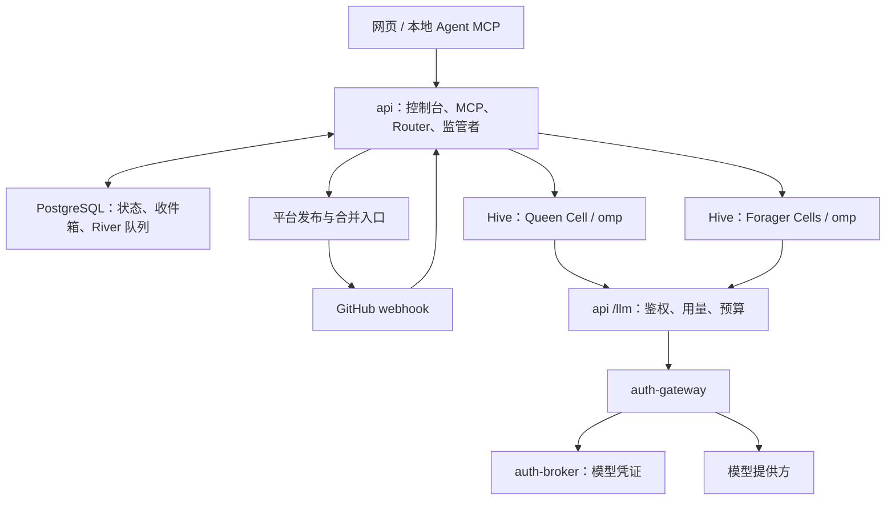

# SwarmJet

SwarmJet 是自托管的 Agent swarm：为 GitHub 仓库创建 **Hive**，让常驻的 **Queen** 协调多个 **Forager** 在 Docker **Cell** 中工作。你可以在网页对话，也可以让本地 Agent 通过 MCP 派活；工作方式由可版本化的方法论定义，代码、模型凭证和运行状态由你自己的服务器保管。

> 本文面向首个公开版本 **v0.1.0**（发布准备中）。已知问题见[变更记录](CHANGELOG.md#已知问题)。

## 核心概念

| 概念 | 含义 |
| --- | --- |
| Hive | 一个 GitHub 仓库及其 Agent、消息、配置、方法论和记忆的边界；Hive 之间隔离。 |
| Queen | 每个 Hive 唯一的常驻管理者。新 Hive 默认开启，负责首次引导、管理方法论、派活、回答提问和处理未被认领的事件；可在设置中关闭。常驻指身份和会话持续，空闲时 Cell 可以停机。 |
| Forager | 承担一件任务的 Agent，按方法论中的角色工作；可以编写代码，也可以只读验证。可写角色在每轮结束后由平台发布分支和 PR。 |
| Cell | Agent 的 Docker 容器、持久工作区和会话文件；内部统一运行 oh-my-pi（`omp acp`），以非 root 用户执行。 |
| 方法论 | 每个 Hive 的协作规则：角色提示词、模型、skill、权限、常驻与事件规则、合并条件和可选预算；每次发布留版本，可回滚。 |

平台负责运行与恢复 Cell、持久消息和重试、事件路由、凭证代理、用量记录、并发与防循环保障，以及强制执行方法论声明的权限和合并条件。方法论决定怎么拆任务、谁验证、哪些事件要处理、什么时候合并；平台没有固定的开发流水线。

新 Hive 不预装方法论，Queen 引导你选择内置的 `pstack` 或极简版，或按你的要求编写、导入。选定前不会自动派 worker。Queen 的核心职责由平台定义，方法论只补充其风格与合并权限。新方法论生效后连续 3 个 Forager 失败会触发回滚到上一版本，并通知 Queen。

`pstack` 是一个可选协作方案：worker 产出 PR，verifier 验证当前 head；合并要求非作者的 PASS 或 PASS_NOTES 与 CI 通过，默认不自动合并。它的流程可以修改，参见[方法论包](methodologies/README.md)。

## 架构



Queue、Router 和监管者都在 `api` 进程内；凭证服务使用独立网络，Cell 通过平台代理调用模型。

## 快速上手

准备 Linux x86_64 服务器、Docker Engine 24+、Compose 插件 2.20+ 和 Python 3。以下固定版本命令在 **v0.1.0 标签及两个 GHCR 包公开后**可用：

```sh
curl -fsSL https://raw.githubusercontent.com/yyydddkkk/SwarmJet/v0.1.0/deploy/install.py \
  | python3 - --image-source ghcr --ref v0.1.0 --version v0.1.0
```

发布前可在本仓库构建：

```sh
python3 deploy/install.py
```

脚本生成配置和密钥、构建或拉取镜像、执行数据库迁移并等待服务健康。默认启用 Cells 与 webhook 临时隧道。控制台为 <http://localhost:8180>；远程部署先建立 SSH 转发：

```sh
ssh -N -L 8180:127.0.0.1:8180 用户名@服务器
```

管理员默认 `admin`，密码在安装目录 `.env` 的 `ADMIN_PASSWORD` 中；安装时加 `--show-password` 可显示。

1. 在网页的 **接入** 页一键创建 GitHub App，并在 GitHub 将它安装到目标仓库。
2. 在 **模型** 页填写模型提供方凭证。没有免费默认模型；默认模型标识为 `deepseek/deepseek-v4-flash`，使用前仍需自己的有效凭证。
3. 通过向导选仓库、创建 Hive；Queen 默认开启，可以选择它使用的模型。
4. 打开 Hive 的 Queen 对话页，让 Queen 介绍并安装方法论，例如：“采用 pstack，先不要自动合并。”
5. 继续在网页交代第一个任务，例如：“修复 Issue #123，完成后给我 PR 和验证结果。”也可以在 **接入** 页新建 MCP 连接，把配置复制到本地 Agent，让它向 Queen 发消息或按方法论派 Forager。

本地 Agent 的连接配置也可在服务器生成：

```sh
python3 deploy/install.py connect --client claude
# 或选择 --client codex
```

本地 Agent 通过 MCP 可以 `send` 给 Queen 或 Forager、`spawn` 按角色派活、`get_methodology` / `publish_methodology` / `activate_methodology` 管理方法论、`pr_status` / `merge_pr` 查看和合并 PR、`wait` 等待报告。完整操作与升级方式见[部署指南](deploy/README.md)。

## 安全模型

- **凭证不进 Cell**：GitHub 凭证留在平台，推送和合并由平台执行；模型凭证由 auth-broker 保管，auth-gateway 调用提供方。Cell 只拿自身作用域的 Agent Token，访问 `/mcp` 和 `/llm/`。
- **仓库可执行输入默认不加载**：仓库扩展、hook、工具与项目 MCP 配置被禁用；规则、skill 及独立的 `AGENTS.md` / `CLAUDE.md` 仍会加载。仓库文本不是提权渠道，平台权限保存在数据库中。
- **外部内容是数据**：GitHub Issue、评论、评审等消息保留外部来源与可信度标记，以数据边界传给 Agent；方法论和平台权限不由其中的指令覆盖。
- **隔离与宿主权限**：Cell 不挂 Docker socket。启用 Cells 会给 `api` 挂载 socket，等同宿主 root 权限；仅在管理员可信的服务器部署。控制台默认仅监听回环地址，临时隧道只开放 webhook。

## 限制与路线图

- 首个版本只支持 GitHub、单机 Docker Compose；发布镜像仅 `linux/amd64`。控制台面向桌面端。
- 模型调用依赖你配置的提供方凭证与服务可用性；用量与花费记录用于观测，方法论可声明预算。
- Hive 的时间线、记忆，以及 Forager 的 Diff、时间线、终端仍是占位页。
- 已知问题（并发上限、自动回滚计数等）见[变更记录](CHANGELOG.md#已知问题)。
- 多机执行、更多代码托管平台及更广的模型接入属于后续方向，目前没有交付承诺。

## 开发与文档

Go 版本以 [go.mod](go.mod) 为准；前端构建使用 Node.js 24（与 CI 一致）。

```sh
go test -race ./cmd/... ./internal/...
go vet ./cmd/... ./internal/...
npm ci --prefix web
npm run build --prefix web
(cd deploy && python3 -m unittest)
```

`./scripts/test.sh` 是本地检查入口；`VALIDATE_DEPLOY=1` 增加 Compose 校验，`RUN_BROWSER_TESTS=1` 增加浏览器测试。

- [部署指南](deploy/README.md)：服务、环境变量、升级、备份与排障。
- [变更记录](CHANGELOG.md)：v0.1.0 用户可见变化与已知问题。
- [API 契约](api/contract.md)、[贡献指南](CONTRIBUTING.md)。

采用 [MIT 许可证](LICENSE)。
